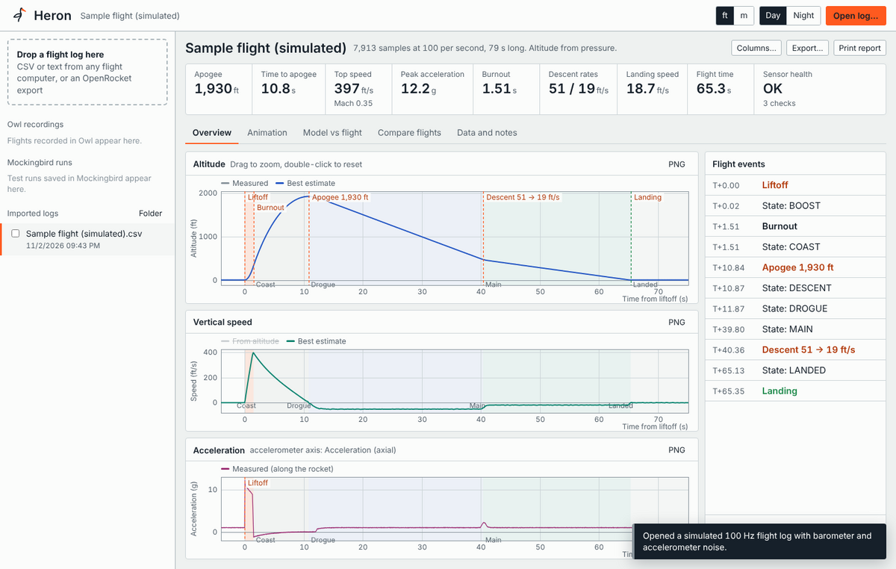
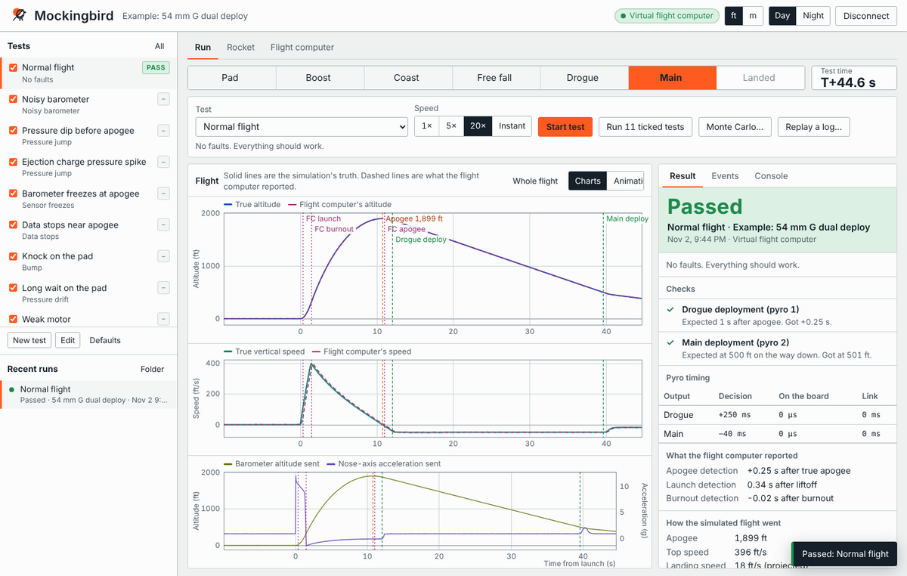
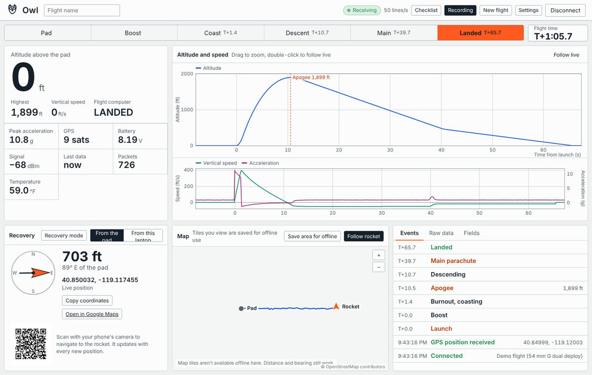

# Aviary

I built Aviary to make rocketry data analysis straightforward, to create an integrated ecosystem of software for my rocketry projects, and to test everything as thoroughly as I can before flight day.

It's three desktop apps that share one simulator and one file format, plus an Arduino library that lets a real flight computer plug into them:

- **Owl** is the ground station. It reads live telemetry over serial or UDP, shows altitude, speed and flight state, and points you at the rocket after landing.
- **Heron** is the flight data analyzer. Drop in a log from a flight computer (or an OpenRocket export) and it finds the events, checks the sensors, and compares the flight to a simulation.
- **Mockingbird** tests a flight computer before it ever flies. It streams a simulated flight to the board, injects faults like a noisy barometer or an early motor burnout, and grades whether the pyro channels fired when they should have.

They run on Windows and Linux (64-bit PCs and Raspberry Pi 4/5).



## Download

Grab the latest build from the [Releases page](https://github.com/Birdbrain-Aviation/aviary/releases).

- **Windows:** unzip and run `Owl.exe`, `Heron.exe` or `Mockingbird.exe`.
- **Linux:** unpack the tarball and run `./install.sh` to add the apps to your applications menu. Serial ports need your user in the `dialout` group.

The full user guide is [`docs/Read me.html`](docs/Read%20me.html) (it's also included in the download).

## Mockingbird



Mockingbird runs a flight computer through a set of test flights: a normal flight, a noisy barometer, a pressure spike from an ejection charge, data dropping out near apogee, a weak motor, and more. You can write your own tests, run a Monte Carlo batch, or replay a real flight log from Heron. There's a built-in virtual flight computer so you can try it without hardware.

To test your own board, add the [MockingbirdHIL](arduino/MockingbirdHIL) library to your flight computer code. It feeds the board simulated barometer, accelerometer, gyro and GPS readings and reports pyro outputs and state changes back to Mockingbird. The library has two examples: a minimal one to try first and one showing how to drop it into existing flight code.

## Owl



Owl figures out which fields your telemetry has (altitude, GPS, battery, signal strength and so on) from the incoming lines, records every flight, and keeps a recovery panel with distance and bearing from the pad or from your laptop, plus a QR code that opens the landing spot on your phone. Map tiles you look at are saved so the map still works at a field with no signal.

## Heron

Heron gives you apogee, top speed, burnout, descent rates and landing speed at a glance, flags sensor problems, and lets you compare several flights side by side. It reads Owl recordings and Mockingbird runs directly, and can turn a real log into a Mockingbird replay so you can re-fly it against new code.

## How the code fits together

- `cmd/owl`, `cmd/heron`, `cmd/mockingbird`: one small Go program per app. Each serves its interface on `127.0.0.1` (ports 47710, 47720 and 47730, fixed so Edge remembers serial-port permissions) and opens it in an Edge app window. It also stores settings and files, relays UDP telemetry for Owl, and caches map tiles. The app quits when its window closes.
- `host/`: that shared Go code. `host_windows.go` finds the Documents folder (OneDrive-aware) and Edge or Chrome.
- `web/`: the interfaces (plain HTML, CSS and JavaScript modules, no build step), embedded into each program.
  - `web/shared/js/sim.js`: the 1-D flight simulator (stages, clusters, recovery, ISA atmosphere, wind drift, sensor models).
  - `web/shared/js/hil.js`: Mockingbird's engine: the wire protocol, fault injection, closed-loop pyro handling, grading, and the virtual flight computer.
  - `web/shared/js/analysis.js`, `flightlog.js`: Heron's log reader and flight analysis.
  - `web/shared/js/health.js`, `replay.js`: Heron's sensor health checks, and turning a log into a Mockingbird replay.
  - `web/shared/js/telemetry.js`, `fields.js`, `map.js`, `qr.js`: Owl's line parser, field recognition, tile map and QR codes.
  - `web/shared/js/flight3d.js`, `flightviz.js`: the 2D and 3D flight animation (WebGL terrain from cached elevation tiles, no libraries).
  - `web/shared/js/serial.js`: Web Serial (Edge and Chrome).
- `arduino/MockingbirdHIL`: the Arduino library for flight computers.
- `tools/winres`: writes the Windows icon, version and manifest resources (standard library only).

## Building from source

You need Go 1.24 or newer. The icons also need `rsvg-convert` and ImageMagick.

```sh
./build-windows.sh          # build/windows/Owl.exe, Heron.exe, Mockingbird.exe
./build-linux.sh            # build/linux/Aviary-<version>-linux-amd64.tar.gz and -arm64.tar.gz
```

On Windows without the icon tools: `go build -ldflags "-H windowsgui" -o Owl.exe ./cmd/owl` (same for heron and mockingbird).

For development, `go run ./cmd/owl` opens the app in your browser. The interface is embedded when the program builds, so after editing anything in `web/`, close the window and run it again.

## Tests

```sh
./build-native-tests.sh     # compiles the Arduino examples to run on this PC
node --test tests/*.test.js # simulator, analysis, protocol, grading, QR, and the library end to end
tests/restart.sh            # starts all three apps without windows for the browser tests
python3 tests/ui_mockingbird.py && python3 tests/ui_mockingbird_serial.py && python3 tests/ui_owl.py && python3 tests/ui_heron.py
```

The browser tests use Playwright for Python. `ui_mockingbird_serial.py` connects a stand-in serial port to the compiled `MockingbirdTry` example, so the interface, serial code, protocol and library all get exercised together.

## Safety

These are tools for testing and watching flights, not a replacement for the NAR/TRA safety codes. A passing Mockingbird test means the flight computer handled the simulated cases, not that it can't fail. Keep pyro channels disarmed until the rocket is on the pad.

## License

MIT. See [LICENSE](LICENSE).
